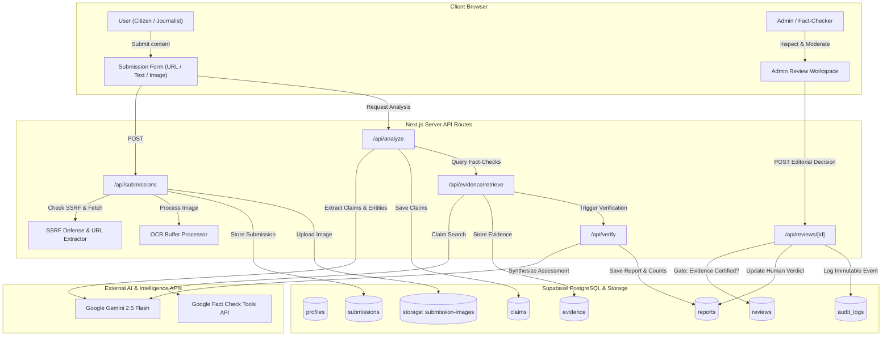

# TruthLens AI — AI-Assisted Election Information Verification Platform

TruthLens AI is an AI-assisted election information verification and claim extraction platform designed to empower citizens, journalists, and election monitors to investigate election-related news, public claims, viral social text, and image screenshots with source-grounded evidence and human editorial oversight.

---

## Table of Contents

1. [Project Overview](#project-overview)
2. [Key Features](#key-features)
3. [Technology Stack](#technology-stack)
4. [System Architecture & Data Flow](#system-architecture--data-flow)
5. [Database Structure](#database-structure)
6. [API Documentation](#api-documentation)
7. [Installation & Setup](#installation--setup)
8. [Environment Variables](#environment-variables)
9. [Testing & Verification](#testing--verification)
10. [Vercel Hobby Deployment Guide](#vercel-hobby-deployment-guide)
11. [Known Limitations & Disclaimers](#known-limitations--disclaimers)
12. [Screenshots & Demo](#screenshots--demo)

---

## 1. Project Overview

Electoral discourse is increasingly impacted by viral misinformation, manipulated imagery, and fabricated polling figures. **TruthLens AI** addresses this challenge through an open, explainable multi-stage pipeline:

1. Ingests raw election statements from news URLs, user text, or screenshots.
2. Extracts verifiable factual statements and strips subjective opinions using Google Gemini.
3. Searches independent claim-review registries via the Google Fact Check Tools API.
4. Synthesizes an evidence-based preliminary AI assessment with explicit confidence bounds and citation grounding.
5. Requires certified human editorial review before any public or certified verdict is rendered, preventing hallucinated conclusions.

---

## 2. Key Features

* **Multi-Modal Content Ingestion**
  * **News Article Extraction**: Extracts structured article content via Cheerio/Readability with comprehensive SSRF defenses (blocking private IPs, CIDR ranges, cloud metadata, and unvalidated redirects).
  * **Manual Text Submissions**: Validates election claims (20–20,000 characters) with prompt injection isolation boundaries.
  * **OCR Image Extraction**: Processes screenshots on-device with Tesseract.js; stores raw images in private Supabase Storage accessed via short-lived signed URLs.
* **Intelligent Claim Extraction & Entity Recognition**
  * Powered by server-side **Google Gemini 2.5 Flash**.
  * Separates empirical, verifiable claims from subjective political opinions.
  * Identifies entities (Persons, Organizations, Locations, Public Policies) and generates objective search queries.
* **Evidence Retrieval & Fact-Check Search Engine**
  * Directly integrates the **Google Fact Check Tools API** (Claim Search endpoint).
  * Normalizes third-party reviews, preserving original publisher ratings and canonical citations.
  * Automatically deduplicates evidence URLs and strips tracking parameters.
* **Evidence-Based Verification Reasoning**
  * Computes preliminary claim-level verdicts (`verified`, `false`, `misleading`, `partially_true`, `unverified`).
  * Enforces a zero-evidence rule: absence of evidence strictly yields `unverified`, never `verified`.
  * Preserves immutable AI preliminary assessments alongside human review decisions.
* **Human Review & Editorial Workflow**
  * Dedicated Review Workspace (`/admin/review/[id]`) for accredited administrators.
  * Four review decisions: `approved`, `flagged`, `rejected`, and `needs_evidence`.
  * **Evidence Inspection Gate**: Reviewers must certify evidence inspection before approving a report.
  * **Mandatory Explanation**: Changing an AI verdict requires at least 10 characters of documented justification.
* **Administrative Analytics & Audit Trail**
  * Real-time metrics from Supabase PostgreSQL (no hardcoded counters).
  * Immutable audit log recorded on every submission, analysis, and editorial action.

---

## 3. Technology Stack

| Technology | Purpose |
| :--- | :--- |
| **Next.js 16 (App Router)** | Modern full-stack React framework with Turbopack, Server Actions, and Route Handlers |
| **React 19 & TypeScript 5** | Type-safe UI components, hooks, and client-side interactivity |
| **Tailwind CSS 4** | Responsive election intelligence design system with dark navy theme |
| **Supabase PostgreSQL** | Relational database with strict Row Level Security (RLS) policies and triggers |
| **Supabase Authentication** | User authentication with secure JWT cookies and session management |
| **Supabase Storage** | Private object storage for submitted screenshots with signed URL access |
| **Google Gemini API (@google/genai)** | Server-side LLM for content understanding, claim extraction, and verification synthesis |
| **Google Fact Check Tools API** | Discovery of accredited third-party fact-check investigations |
| **Tesseract.js** | Optical character recognition (OCR) engine for image-based claims |
| **Zod 4** | Strict schema validation for incoming payloads, database models, and AI outputs |
| **Vercel** | Edge-optimized deployment platform with continuous integration |

---

## 4. System Architecture & Data Flow

The following sequence outlines how raw user submissions progress through AI claim extraction, evidence retrieval, reasoning, and human moderation:



---

## 5. Database Structure

All database interactions are protected by PostgreSQL Row Level Security (RLS). Ordinary users can only access their own submissions and reports, while administrators can review platform submissions.

* **`public.profiles`**: Extends `auth.users` with user full name, avatar, and role (`user` vs `admin`). Role escalation is blocked by triggers.
* **`public.submissions`**: Stores URL, manual text, and image submissions with extraction status, error logs, and storage keys.
* **`public.claims`**: Granular verifiable claims extracted from submissions, with category, entity lists, preliminary AI verdicts, and human verdicts.
* **`public.evidence`**: Catalogued fact-checks and primary citations linked to claims, with stance (`supporting`, `refuting`, `neutral`), publisher ratings, and canonical URLs.
* **`public.reports`**: AI-generated synthesis reports with methodology, claim findings, overall preliminary verdict, and final human review outcome.
* **`public.reviews`**: Immutable editorial moderation history storing reviewer decisions, certification of evidence inspection, and justification notes.
* **`public.audit_logs`**: Immutable forensic security log recording actor ID, IP address, action, and state diffs.

---

## 6. API Documentation

All routes require authentication and validate inputs with Zod.

| Method | Endpoint | Access | Purpose |
| :--- | :--- | :--- | :--- |
| `POST` | `/api/submissions` | Authenticated | Create a URL, manual text, or multipart image submission |
| `GET` | `/api/submissions` | Authenticated | List submissions (user sees own; admin with `?scope=all` sees all) |
| `GET` | `/api/submissions/[id]` | Author / Admin | Fetch full submission details, signed image URL, and status |
| `POST` | `/api/submissions/extract-url` | Authenticated | SSRF-safe URL scraping and article text extraction |
| `POST` | `/api/submissions/ocr` | Authenticated | On-demand image OCR text extraction |
| `POST` | `/api/analyze` | Author / Admin | Trigger Gemini claim extraction and entity recognition |
| `POST` | `/api/evidence/retrieve` | Author / Admin | Query Fact Check Tools API and catalogue evidence |
| `POST` | `/api/verify` | Author / Admin | Generate evidence-grounded AI preliminary verification report |
| `GET` | `/api/reviews/[id]` | Author / Admin | Load review workspace data (submission, claims, evidence, report) |
| `POST` | `/api/reviews/[id]` | Admin Only | Submit editorial moderation decision (Approve/Flag/Reject/Needs Evidence) |
| `GET` | `/api/admin/analytics` | Admin Only | Fetch real-time dashboard analytics, queue items, and activity feed |
| `GET` | `/api/admin/submissions` | Admin Only | Filter and search submissions across all users |

---

## 7. Installation & Setup

### Prerequisites
* Node.js 18+ (tested with Node.js v22)
* Supabase Project
* Google Gemini API Key
* Google Fact Check Tools API Key

### Step-by-Step Setup

```bash
# 1. Clone repository
git clone https://github.com/Abhishek9885/TruthLens-AI.git
cd TruthLens-AI

# 2. Install dependencies
npm install

# 3. Configure environment variables
cp .env.example .env.local
# Open .env.local and populate credentials
```

### Database Initialization
Run the following SQL migration scripts in your Supabase Dashboard (**SQL Editor**):
1. `supabase/schema.sql` (Core tables, triggers, and baseline RLS policies)
2. `supabase/migrations/20261126_human_review_workflow.sql` (Human review workflow, editorial decisions, and atomic RPC)

### Run Locally
```bash
npm run dev
```
Navigate to `http://localhost:3000`.

---

## 8. Environment Variables

| Variable | Required? | Location | Description |
| :--- | :---: | :--- | :--- |
| `NEXT_PUBLIC_SUPABASE_URL` | Yes | Client & Server | Supabase project URL (`https://xyz.supabase.co`) |
| `NEXT_PUBLIC_SUPABASE_ANON_KEY` | Yes | Client & Server | Public Supabase anon key |
| `GEMINI_API_KEY` | Yes | Server Only | Google AI Studio API key |
| `GEMINI_MODEL` | No | Server Only | Model identifier (defaults to `gemini-2.5-flash`) |
| `GOOGLE_FACTCHECK_API_KEY` | Yes | Server Only | Google Cloud API key with Fact Check Tools API enabled |
| `NEXT_PUBLIC_APP_URL` | Yes | Client & Server | Canonical URL (`http://localhost:3000` or production URL) |

---

## 9. Testing & Verification

TruthLens AI includes automated regression and security test suites:

```bash
# Run Day 7 End-to-End & Security Audit Test Suite (49 assertions)
node "C:\Users\abhis\.gemini\antigravity\brain\1f73bfa6-6cf3-440c-b4f5-f03c8e146a09\scratch\test_day7_e2e_security.mjs"

# Run Day 6 Admin Review & Human Moderation Test Suite (41 assertions)
node "C:\Users\abhis\.gemini\antigravity\brain\1f73bfa6-6cf3-440c-b4f5-f03c8e146a09\scratch\test_day6_admin_review.mjs"

# Run ESLint Check
npm run lint

# Run Production Build
npm run build
```

---

## 10. Vercel Hobby Deployment Guide

To deploy TruthLens AI to Vercel Hobby:

1. Push your repository to GitHub.
2. In the [Vercel Dashboard](https://vercel.com/dashboard), click **New Project** and import `TruthLens-AI`.
3. Configure the **Build & Development Settings**:
   * **Framework Preset**: Next.js
   * **Build Command**: `npm run build`
   * **Install Command**: `npm install`
4. Add the **Environment Variables**:
   * `NEXT_PUBLIC_SUPABASE_URL`
   * `NEXT_PUBLIC_SUPABASE_ANON_KEY`
   * `GEMINI_API_KEY`
   * `GEMINI_MODEL` (`gemini-2.5-flash`)
   * `GOOGLE_FACTCHECK_API_KEY`
   * `NEXT_PUBLIC_APP_URL` (set to your Vercel domain, e.g. `https://truthlens-ai.vercel.app`)
5. In Supabase Dashboard -> **Authentication** -> **URL Configuration**:
   * Add your Vercel deployment URL to **Site URL** and **Redirect URLs** (e.g. `https://truthlens-ai.vercel.app/**`).
6. Click **Deploy**.

---

## 11. Known Limitations & Disclaimers

> [!WARNING]
> **Prototype Disclaimer**: TruthLens AI is an academic demonstration and engineering prototype. It is **not** an accredited election administration authority.

* **Non-Exhaustive Fact Check Coverage**: The Google Fact Check Tools API catalogues claim reviews from participating International Fact-Checking Network (IFCN) signatories. Breaking claims or localized election claims may have no recorded reviews yet.
* **LLM Stochasticity**: Large language models can make errors in extraction and interpretation. All Gemini-generated assessments are explicitly marked as **Preliminary** and unverified until human certification.
* **Absence of Evidence**: The lack of fact-checking articles does **not** prove a claim true or false; the system classifies such claims as `unverified`.
* **OCR Text Fidelity**: Optical Character Recognition identifies text within images but does not verify whether the screenshot is digitally manipulated or synthetic.

---

## 12. Screenshots & Demo

*(Screenshots of the User Dashboard, Claim Extraction Workspace, Fact-Check Evidence Cards, and Admin Editorial Console will be presented during project demonstration).*
